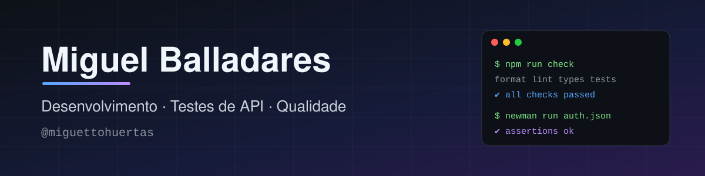

 

<!-- Quando o portfólio estiver no ar, descomente e ajuste o link:

-->

---

##  Sobre mim

Sou **Miguel Angel Balladares Huertas**. Desenvolvo sistemas e apps e gosto de entregar com **qualidade verificável**: testes automatizados, análise estática, documentação e decisões de arquitetura registradas.

-  Construo sistemas completos, do protótipo no Figma ao banco de dados, em **Delphi** e em **TypeScript**.
-  Automatizo **testes de API** com Postman/Newman e documento os bugs que encontro.
-  Documento a arquitetura (modelo C4, ADRs) e mantenho histórico de commits limpo.
-  Trabalho na **Youngtech Sistemas**.

---

##  Projetos em destaque

| Projeto | O que é | Tecnologias |
|---|---|---|
| [**BarberManager**](https://github.com/miguettohuertas/BarberManager) | Sistema para gestão de barbearias: app do cliente com agendamento e dashboard do administrador com KPIs em tempo real. Inclui diagramas C4, protótipo, roadmap e relatório de bugs. |     |
| [**TattDraw**](https://github.com/miguettohuertas/tattdraw) | App para tatuadores desenharem a tatuagem num modelo 3D do corpo do cliente e gravarem um vídeo do resultado. Roda no navegador e no Android. |     |
| [**rebel-bots**](https://github.com/miguettohuertas/rebel-bots) | Jogo educacional desenvolvido para contribuir com a comunidade regional (fork de projeto colaborativo). |  |
| [**FitTrack**](https://github.com/miguettohuertas/FitTrack-main) | Projeto em JavaScript usado para prática de análise de qualidade com Mend. |  |

---

##  Testes e qualidade

| O quê | Como |
|---|---|
| **Testes de API** | Coleções Postman/Newman para os módulos de autenticação, serviços e agendamentos do BarberManager, com relatório de bugs em `docs/Qualidade`. |
| **Testes unitários** | Vitest no TattDraw, com a lógica de pintura isolada da interface para ser testável. |
| **Análise estática** | ESLint, Prettier e TypeScript em modo estrito; SonarQube configurado no BarberManager; análise com Mend no FitTrack. |
| **CI/CD** | GitHub Actions rodando as verificações a cada push no TattDraw. |
| **Boas práticas** | Conventional Commits, versionamento semântico, CHANGELOG, ADRs e Git LFS para assets pesados. |

---

##  Tecnologias

**Linguagens**

**Front-end, mobile e 3D**

**Dados**

**Testes, qualidade e DevOps**

---

##  GitHub em números

---

 Vamos conversar? Me chame no [LinkedIn](https://www.linkedin.com/in/miguel-balladares-48658035a/).

